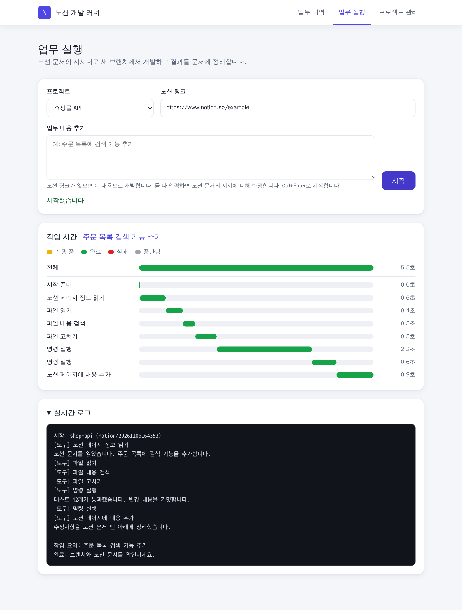
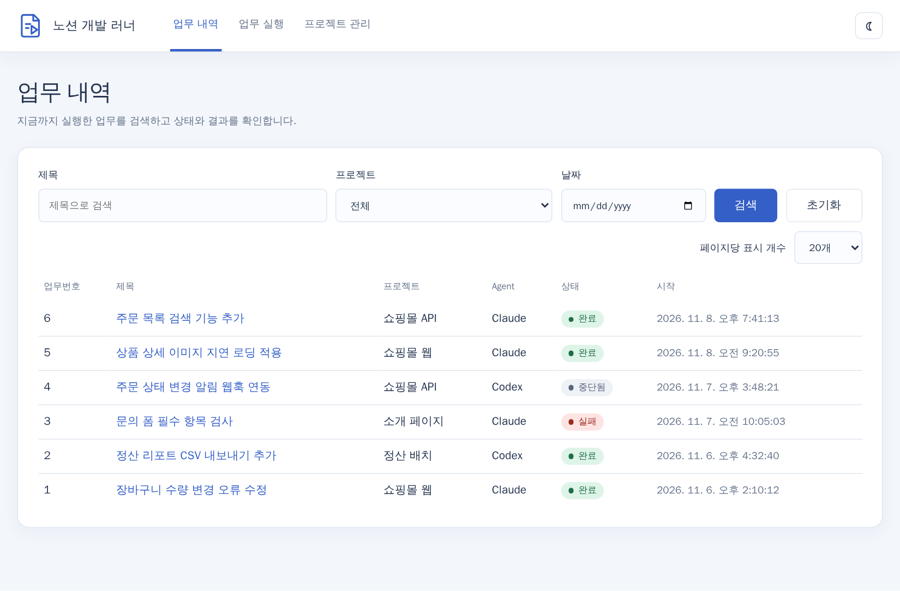
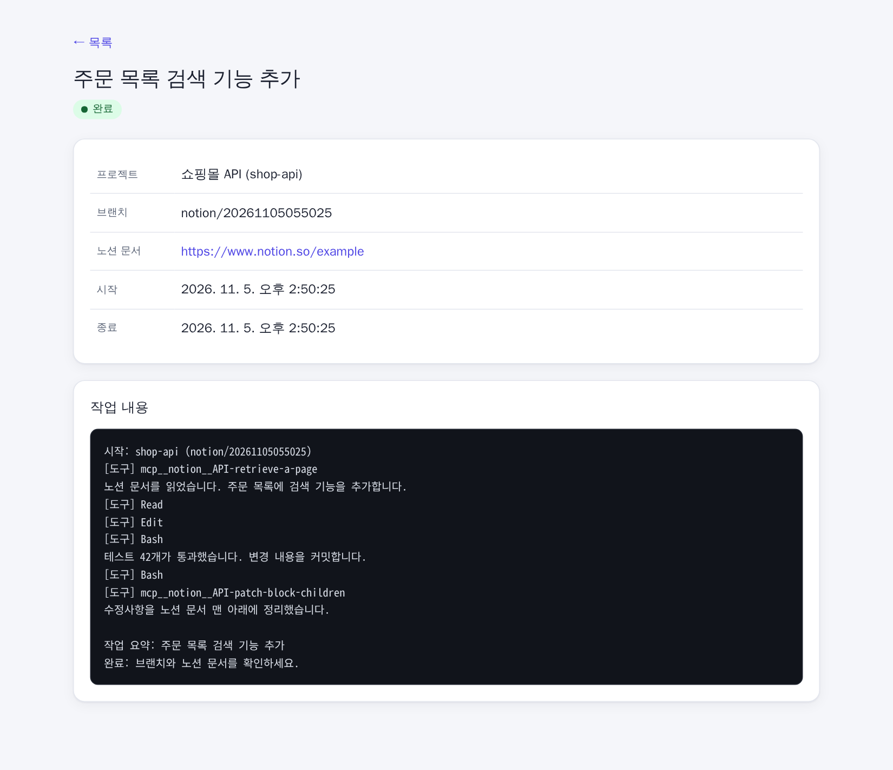
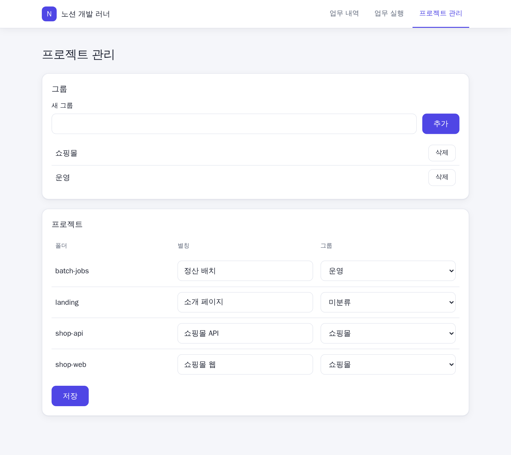

# 노션 개발 러너

노션 문서에 할 일을 적고 프로젝트와 링크만 입력하면, Claude Code가 새 브랜치에서 개발하고 수정사항을 그 문서에 정리해 주는 개인용 로컬 웹 도구입니다.



> 스크린샷의 프로젝트와 작업은 설명을 위한 가상 데이터입니다.

## 주요 기능

- **자동 개발:** 노션 문서의 지시대로 새 `notion/<시각>` 브랜치에서 수정하고 커밋합니다. 머지와 푸시는 직접 합니다.
- **결과 정리:** 변경 요약, 변경 파일, 테스트 결과, 남은 문제를 노션 문서 맨 아래에 추가합니다.
- **업무 실행과 업무 내역:** `업무 실행` 화면에서 업무를 시작하고 진행 상황을 실시간 로그로 보며, 첫 화면인 `업무 내역`에서 지난 작업을 제목과 날짜로 검색합니다.
- **프로젝트 관리:** 폴더에 별칭을 붙이고 그룹으로 묶어 선택합니다.
- **실행 Agent 선택:** 업무 실행 화면의 `실행 Agent`에서 Claude 또는 Codex를 고릅니다. 마지막 선택은 브라우저에 기억되고, 업무 내역과 상세 화면에 어느 Agent로 실행했는지 표시됩니다. Codex는 `codex exec`로 같은 프롬프트, 같은 브랜치 흐름, 같은 노션 MCP 연결을 씁니다. Codex의 명령 실행은 설명이 없어 `명령 실행`만 표시됩니다.
- **테스트는 직접:** Claude는 테스트와 화면 확인을 하지 않고 개발과 정리만 합니다. 문서에 테스트를 명시하면 그때만 합니다. 컨테이너에는 Python, pytest, Docker, Chromium이 들어 있습니다.

## 동작 방식

```
브라우저 폼 → 입력 검사 → 새 git 브랜치 → Claude Code (Notion MCP) → 커밋과 노션 정리
                                                  └→ 실시간 로그, 업무 내역(SQLite)
```

서버는 의존성 없는 Node.js이고 Docker로 실행합니다. 포트는 이 PC(`127.0.0.1`)에만 열립니다. 혼자 쓰는 도구라 로그인 기능이 없습니다.

## 준비

필요한 것은 Docker Desktop, Claude Code 로그인, Codex 로그인, Git 설정(`~/.gitconfig`)입니다. Codex는 이 PC의 `%USERPROFILE%\.codex\auth.json` 파일만 컨테이너에 연결하므로, 이 파일이 없으면 컨테이너가 시작되지 않습니다.

1. 저장소를 `D:\fsd\fsd`에 받습니다. `docker-compose.yml`이 `D:/fsd`를 프로젝트 폴더로 연결하므로, 위치가 다르면 이 경로를 수정합니다.
2. https://www.notion.so/my-integrations 에서 내부 통합을 만들고 토큰을 복사합니다. 콘텐츠 읽기, 업데이트, 삽입 권한이 필요합니다.
3. 이 폴더의 `.env` 파일에 토큰을 저장합니다: `NOTION_TOKEN=토큰`
4. 작업할 노션 페이지의 `•••` → `연결` 메뉴에서 그 통합을 추가합니다.

프로젝트는 `D:\fsd\<이름>` 폴더에 있어야 하고, git 저장소이며 커밋하지 않은 변경이 없어야 합니다.

## 실행

```
docker compose up -d --build
```

브라우저에서 http://127.0.0.1:4317 을 엽니다. 토큰을 바꾸거나 코드를 수정한 뒤에는 같은 명령을 다시 실행합니다.

## 사용법

1. 노션 페이지에 할 일을 적습니다. 예: `주문 목록에 검색 기능 추가`
2. 상단 메뉴의 `업무 실행` 화면에서 프로젝트를 고르고 노션 페이지 링크를 붙여 넣은 뒤 **시작**을 누릅니다. 데이터베이스 항목이라면 데이터베이스가 아니라 항목 페이지의 링크를 넣습니다.

   노션 링크 아래의 `업무 내용 추가`에 할 일을 적으면 노션 링크 없이도 시작할 수 있습니다(10000자 이내, Ctrl+Enter로 시작). 이때는 노션에 아무것도 쓰지 않고, 수정사항 정리를 Claude의 마지막 응답(실시간 로그와 작업 상세 화면)에 남기며 `NOTION_TOKEN`도 필요 없습니다. 링크와 업무 내용을 둘 다 넣으면 노션 문서의 지시에 업무 내용을 더해 진행합니다. 둘 다 비어 있으면 거부합니다.
3. 버튼 아래의 메시지를 확인합니다. 시작할 수 없으면 `거부됨`과 이유가 표시됩니다.
4. `실시간 로그`에서 진행 상황을 봅니다. 제목을 누르면 접고 펼칠 수 있습니다.
5. 끝나면 노션 문서의 정리 내용과 새 브랜치의 커밋을 확인합니다.
6. 변경이 괜찮으면 직접 머지합니다.

   ```
   git switch main
   git merge notion/<시각>
   ```

한 번에 작업 하나만 실행할 수 있습니다.

## 업무 내역





실행한 작업은 SQLite DB에 저장되어 첫 화면인 `업무 내역`에 페이지당 기본 20건씩 프로젝트(별칭이 있으면 별칭), Agent(Claude 또는 Codex), 상태(대기 중, 실행 중, 완료, 실패, 중단됨)와 함께 표시되며, 제목, 프로젝트, 시작 날짜로 검색할 수 있습니다. 목록 위의 `페이지당 표시 개수`에서 10·20·50·100건을 선택할 수 있으며, 변경하면 검색 조건을 유지한 채 첫 페이지로 이동합니다. 제목은 Claude가 마지막 응답에 적은 작업 요약이고, 요약이 없으면(실행 중이거나 이전 기록) `프로젝트 · 브랜치`로 표시됩니다. 제목을 누르면 브랜치, 노션 링크, 입력한 업무 내용, 시작·종료 시각과 작업 로그를 볼 수 있습니다. 작업을 끝까지 마치면 Claude가 노션 페이지의 `상태` 속성을 `완료`로 바꿉니다. 서버가 작업 도중 종료되면 그 작업과 대기 중이던 작업은 다음 실행 때 `중단됨`으로 바뀝니다. 상세 화면에서 `자세히`를 고르면 도구 호출마다 걸린 시간이 막대로 표시됩니다(진행 중은 노란색, 완료는 초록색). 각 막대는 그 도구를 부른 때부터 다음 도구를 부를 때까지(마지막은 작업이 끝날 때까지)이고, 첫 도구 전의 시간은 `시작 준비`로 따로 표시되므로 막대 시간을 모두 더하면 `전체` 시간과 같습니다. 실시간 로그와 막대의 도구 이름은 `파일 읽기`, `명령 실행`, `노션 페이지에 내용 추가`처럼 쉬운 한글로 표시됩니다. `명령 실행`은 실행한 명령 대신 Claude가 적은 짧은 명령 설명(40자까지, 설명이 없으면 생략)을 함께 보여 줍니다. 로그에서 같은 도구를 연달아 부르면 `[도구] 명령 실행 ×3`처럼 한 줄로 묶고 각 실행 내용을 그 아래에 나열하며, 중간에 다른 내용이 끼면 따로 묶습니다. `작업 시간` 막대도 같은 도구를 연달아 부르면 `명령 실행 ×6`처럼 한 줄로 묶어 그 구간 전체를 표시합니다. `업무 실행` 화면의 `작업 시간` 카드에도 같은 막대가 실시간으로 나옵니다.

DB 위치는 `RUNNER_DB` 환경 변수로 정하며, 기본값은 이 폴더의 `runner.db`입니다. Docker에서는 `runner-data` 볼륨의 `/data/runner.db`에 저장되어 컨테이너를 다시 만들어도 유지됩니다. 기록을 지우려면 `docker compose down -v`로 볼륨을 삭제합니다.

## 작업 대기

작업이 실행 중일 때 시작을 누르면 `대기 중`으로 기록되고, 앞선 작업이 끝나면 요청한 순서대로 하나씩 실행됩니다. 프로젝트가 달라도 동시에 실행하지 않습니다. 같은 프로젝트에 같은 노션 링크와 같은 업무 내용의 작업이 이미 실행 중이거나 대기 중이면 거부합니다.

브랜치는 실제로 시작할 때 만들어지고, 그때 저장소에 커밋하지 않은 변경이 있으면 그 작업은 `실패`로 기록된 뒤 다음 작업으로 넘어갑니다. 같은 프로젝트의 대기 작업은 앞선 작업의 브랜치 위에서 이어집니다. 대기 중인 작업의 시작 시각은 요청한 시각이며, 실제로 시작하면 그 시각으로 바뀝니다.

## 프로젝트 관리



상단 메뉴의 `프로젝트 관리`를 누르면 별도 페이지(`/projects`)가 열립니다. 여기서 그룹을 추가·삭제하고, 폴더마다 별칭(50자 이내)을 적고 그룹을 선택합니다. 프로젝트 선택 목록은 그룹별로 묶여 별칭으로 표시되고, 그룹이 없으면 `미분류`에 들어갑니다. 그룹은 쓰는 프로젝트가 없어도 남아 있으며, 삭제하면 그 그룹의 프로젝트는 `미분류`로 옮겨집니다. 그룹 이름은 50자 이내이고 `미분류`는 쓸 수 없습니다. 실행에는 계속 실제 폴더명을 씁니다.

## 테스트 환경

러너 이미지에는 Python, pytest, Docker CLI와 Compose, Playwright와 Chromium이 들어 있습니다. Docker 명령은 호스트가 아니라 별도의 `docker` 서비스에서 실행되므로 호스트의 컨테이너에는 접근하지 않습니다. 프로젝트에서 공개한 포트는 `docker` 호스트로 접속합니다. 받은 이미지는 `docker-data` 볼륨에 쌓이며, 이 볼륨도 `docker compose down -v`로 지워집니다.

러너 자체의 테스트는 `node --test`로 실행합니다.

## 주의

Claude는 권한 확인 없이(`bypassPermissions`), Codex는 승인과 샌드박스 없이(`--dangerously-bypass-approvals-and-sandbox`) 실행됩니다. 컨테이너에는 `D:\fsd` 전체와 Claude·Codex 로그인 정보가 연결되어 있어, 이 폴더의 다른 프로젝트를 건드릴 수 있고 노션 문서에 들어간 악성 지시도 그대로 실행될 수 있습니다. **본인이 작성한 문서에만 사용하세요.**

`docker` 서비스는 `privileged`로 실행됩니다. 호스트 컨테이너와는 분리되지만, 악성 지시가 실행되면 이 서비스를 통해 Docker VM 수준의 권한을 얻을 수 있습니다.

작업 로그에는 Claude의 응답과 표준 오류 출력이 그대로 저장됩니다. 비밀 값이 출력되면 DB에도 남을 수 있습니다.
